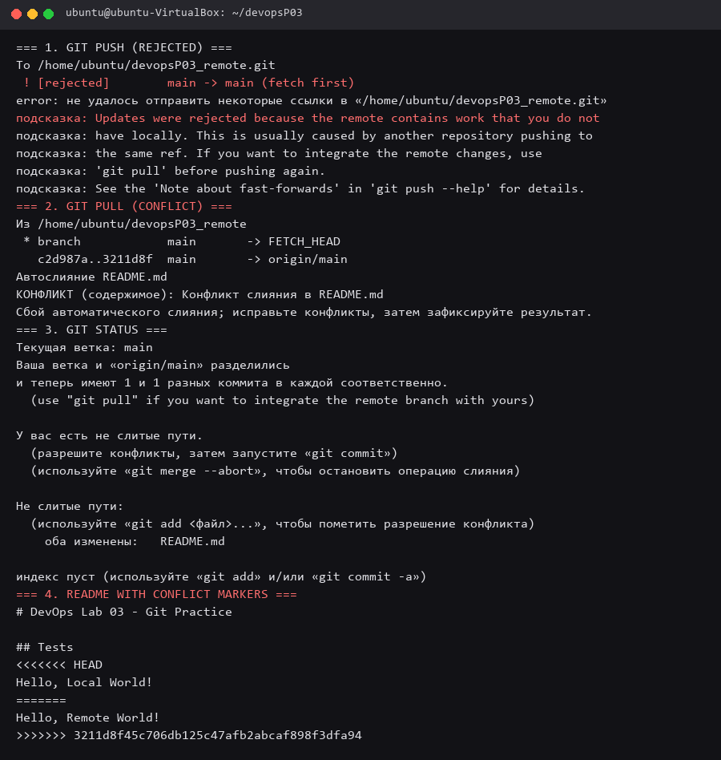
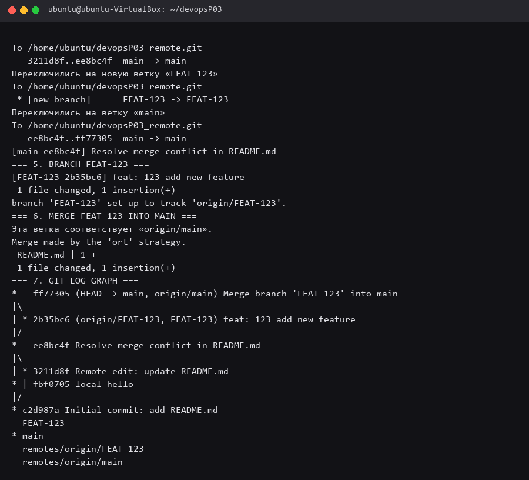

# П03. Системы контроля версий на примере Git

## Описание работы
Практическая работа №3 по курсу DevOps:
1. Настроены глобальные параметры Git (`user.name`, `user.email`, `pull.rebase false`).
2. Создан локальный репозиторий с файлом `README.md`, выполнены локальные коммиты и привязка к удалённому репозиторию (`origin`).
3. Смоделирован и разрешён **конфликт слияния (Merge Conflict)** при одновременном изменении `README.md` локально и на удалённом сервере (`git push` -> `rejected`, `git pull` -> `CONFLICT`, ручное удаление маркеров конфликта, `git add`, `git commit`, `git push`).
4. Создана отдельная ветка разработки `FEAT-123` (`git checkout -b FEAT-123`), внесены изменения, ветка отправлена на сервер (`git push -u origin FEAT-123`) и выполнена интеграция в основную ветку `main` (`git merge --no-ff FEAT-123`).

## Структура репозитория
* `README.md` — описание выполненной работы, ход отработки конфликта и результаты.
* `screenshots/` — скриншоты этапов работы с Git.

---

## Ход выполнения работы и результаты

### 1. Создание и разрешение конфликта слияния
После расхождения локальной ветки `main` и `origin/main` выполнена попытка `git push` (отклонена сервером), затем `git pull` (обнаружен конфликт в `README.md`), проверка через `git status` и просмотр маркеров конфликта:

---

### 2. Разрешение конфликта, ветка `FEAT-123` и граф коммитов
Конфликт в `README.md` разрешён и зафиксирован коммитом, затем создана и отправлена ветка `FEAT-123`, выполнен merge в `main` и проверен журнал `git log --oneline --graph --all --decorate`:

